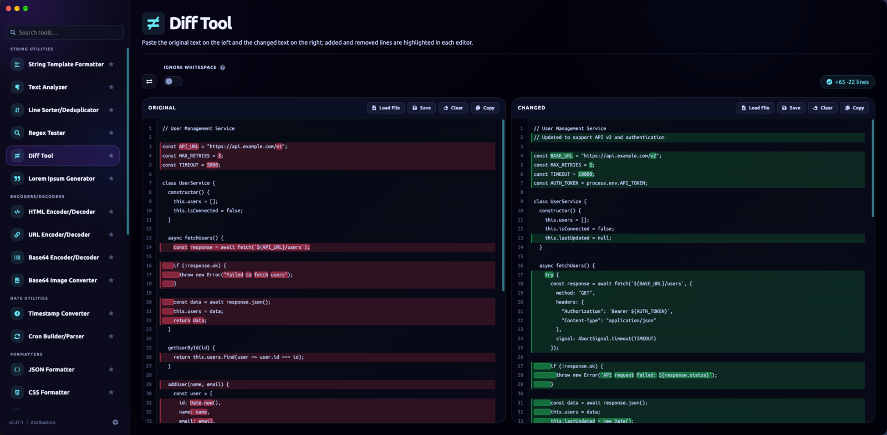
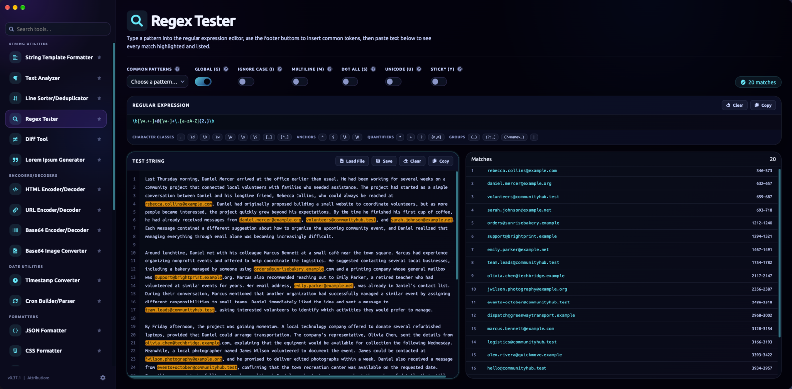
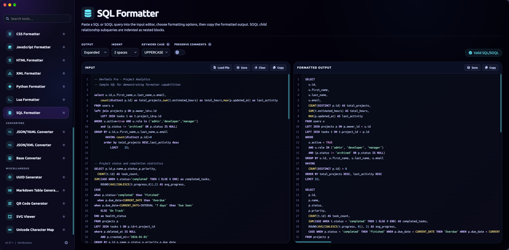
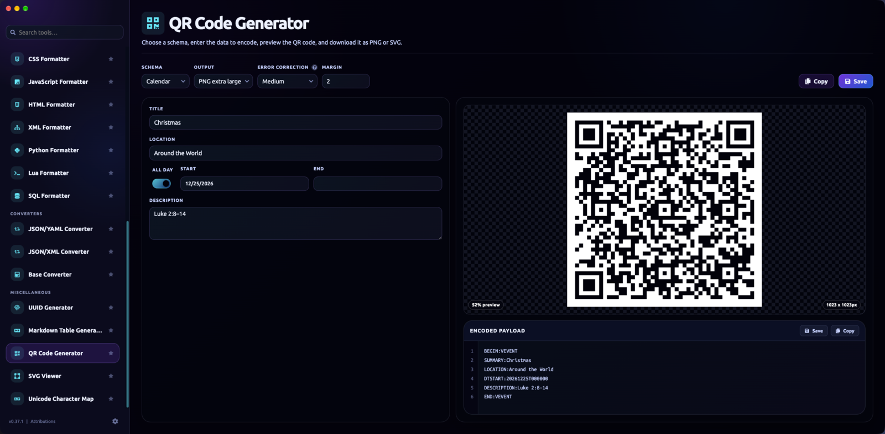
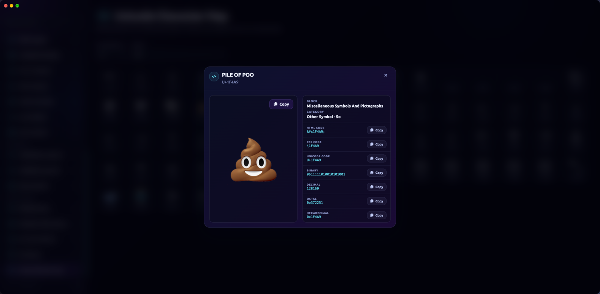

# Cody's Dev Tools

[](https://github.com/codysechelski/codys-dev-tools-two/releases/latest)
[](https://github.com/codysechelski/codys-dev-tools-two/actions/workflows/ci.yml)
[](https://github.com/codysechelski/codys-dev-tools-two/releases)
[](#download)
[](LICENSE)
[](https://vuejs.org/)
[](https://www.typescriptlang.org/)
[](https://www.electronjs.org/)

A collection of everyday developer tools — formatters, converters, encoders, generators — in one app. Runs as a website or as a native desktop app for macOS, Windows, and Linux. Everything runs locally: nothing you type is sent anywhere.

<picture>
  <source media="(prefers-color-scheme: dark)" srcset="docs/screenshots/diff-tool-dark.png">
  <source media="(prefers-color-scheme: light)" srcset="docs/screenshots/diff-tool-light.png">
  
</picture>

[](https://ko-fi.com/X2B128UDFL)

## Screenshots

<table>
  <tr>
    <td width="50%"><picture>
  <source media="(prefers-color-scheme: dark)" srcset="docs/screenshots/regex-tester-dark.png">
  <source media="(prefers-color-scheme: light)" srcset="docs/screenshots/regex-tester-light.png">
  
</picture><br><sub><b>Regex Tester</b> — every match highlighted and listed</sub></td>
    <td width="50%"><picture>
  <source media="(prefers-color-scheme: dark)" srcset="docs/screenshots/sql-formatter-dark.png">
  <source media="(prefers-color-scheme: light)" srcset="docs/screenshots/sql-formatter-light.png">
  
</picture><br><sub><b>SQL Formatter</b> — SQL and SOQL, with configurable output</sub></td>
  </tr>
  <tr>
    <td width="50%"><picture>
  <source media="(prefers-color-scheme: dark)" srcset="docs/screenshots/qr-code-generator-dark.png">
  <source media="(prefers-color-scheme: light)" srcset="docs/screenshots/qr-code-generator-light.png">
  
</picture><br><sub><b>QR Code Generator</b> — URLs, Wi-Fi, contacts, calendar events, and more</sub></td>
    <td width="50%"><picture>
  <source media="(prefers-color-scheme: dark)" srcset="docs/screenshots/unicode-character-map-dark.png">
  <source media="(prefers-color-scheme: light)" srcset="docs/screenshots/unicode-character-map-light.png">
  
</picture><br><sub><b>Unicode Character Map</b> — browse, search, and copy any encoding</sub></td>
  </tr>
</table>

Light and dark themes are both built in — the screenshots above follow your GitHub theme.

## Download

If you just want to use the app, grab the latest build from the **[Releases page](https://github.com/codysechelski/codys-dev-tools-two/releases/latest)**:

| Platform | File |
| --- | --- |
| macOS | `.dmg` |
| Windows | `.exe` installer |
| Linux (Debian/Ubuntu) | `.deb` |

> **Note:** these builds aren't code-signed (that requires a paid Apple/Microsoft developer certificate). macOS Gatekeeper and Windows SmartScreen will warn that the app is from an "unidentified developer" — you'll need to explicitly allow it to run (macOS: right-click → Open; Windows: "More info" → "Run anyway").

Prefer the browser? The app also runs as a static website — see [Building the web app](#building-the-web-app) below if you want to self-host it.

## Tools

**Formatters**

- JSON Formatter validates, formats, minifies, and sorts JSON.
- CSS Formatter outputs expanded, nested, compact, or compressed CSS and can sort declarations or preserve comments.
- JavaScript Formatter formats and compacts JavaScript with syntax-highlighted editors.
- HTML Formatter formats and minifies HTML with syntax-highlighted editors.
- XML Formatter formats and minifies XML.
- Python Formatter formats Python with syntax-highlighted editors.
- Lua Formatter formats Lua scripts with syntax-highlighted editors.
- SQL Formatter formats and validates SQL and SOQL (Salesforce) queries — expanded, compact, or minified output, configurable keyword case, and SOQL child relationship subqueries indented as nested blocks.

**Converters**

- JSON/YAML Converter converts between JSON and YAML.
- JSON/XML Converter converts between JSON and XML.
- Base Converter converts numbers between binary, octal, decimal, hexadecimal, and any base from 2 to 36.

**Encoders/Decoders**

- HTML Encoder/Decoder encodes and decodes HTML entities.
- URL Encoder/Decoder encodes and decodes URLs and URL components.
- Base64 Encoder/Decoder encodes and decodes base64 text.
- Base64 Image Converter converts images to base64 (and back), with CSS/HTML snippet output.

**String Utilities**

- String Template Formatter formats delimited rows using template placeholders.
- Text Analyzer counts paragraphs, words, characters, readability-style stats, and ranked word frequency.
- Line Sorter/Deduplicator sorts and de-duplicates lines of text.
- Regex Tester builds and tests regular expressions, with syntax highlighting, token-insert helpers, and every match highlighted and listed against your test text.
- Diff Tool compares two texts and highlights added/removed lines directly in each editor.
- Lorem Ipsum Generator creates words, paragraphs, lists, and definition lists with optional punctuation and inline HTML variation.

**Date Utilities**

- Timestamp Converter builds dates from parts, picks dates with a custom themed picker, parses timestamps, and converts common timestamp formats.
- Cron Builder/Parser builds and explains cron schedules with upcoming local run times.

**Miscellaneous**

- UUID Generator creates UUID v4 identifiers.
- Markdown Table Generator builds Markdown tables from a simple grid editor.
- QR Code Generator creates PNG and SVG QR codes for text, URLs, Wi-Fi, contacts, email, SMS, phone, and calendar events.
- SVG Viewer previews SVG markup live as you edit it, next to an XML-highlighted source editor.
- Unicode Character Map browses Unicode blocks, filters by character name, and copies character encodings.

## Development

Want to run it from source, or contribute a change? Here's what you need.

### Prerequisites

- [Node.js](https://nodejs.org/) 22.22.2 or newer (see the `engines` field in `package.json`)
- npm (ships with Node)

### Setup

```bash
git clone https://github.com/codysechelski/codys-dev-tools-two.git
cd codys-dev-tools-two
npm install
```

### Running it locally

```bash
npm run dev        # Electron app, with hot reload
npm run dev:web    # browser version, at http://localhost:5173 (use --host to expose it on your network)
```

### Testing

```bash
npm run typecheck  # TypeScript / Vue type checking
npm test           # unit tests (Vitest)
npm run test:watch # unit tests in watch mode
```

### Building the web app

```bash
npm run build:web
```

Outputs static files to `dist/` — deploy that folder to any static host (nginx, Caddy, GitHub Pages, S3, etc.). Preview the production build locally with `npm run preview`.

### Building the desktop apps

```bash
npm run dist:mac     # macOS .dmg + .zip (universal binary)
npm run dist:win     # Windows .exe installer + .zip
npm run dist:linux   # Debian .deb
npm run dist:all     # all three
```

Output lands in `release/`. These are the same commands the [release pipeline](#releases) runs — you can build any of them locally without needing CI.

## Releases

Releases are fully automated with [semantic-release](https://semantic-release.gitbook.io/): every push to `main` is analyzed for [Conventional Commits](https://www.conventionalcommits.org/) (`feat:`, `fix:`, etc.), and when one warrants a release, CI bumps the version, tags it, publishes a GitHub Release with generated notes, and builds + attaches the macOS/Windows/Linux installers automatically. See [CONTRIBUTING.md](CONTRIBUTING.md#commit-messages) for the commit message format this relies on.

## Philosophy

This project isn't trying to be the biggest Swiss Army knife of developer tools. The goal is a **focused collection of practical tools** that lots of developers reach for regularly, each one done well.

That means new tools are added deliberately. If there's a tool that would be genuinely useful to a broad set of developers, and enough people want it, I'm happy to build it, or to work with you on contributing it. What I'd rather avoid is a long tail of niche tools that only a handful of people would use, since every tool added is one more to maintain and one more item to scroll past in the sidebar.

If you have an idea, [open a feature request](https://github.com/codysechelski/codys-dev-tools-two/issues/new?template=feature_request.md) and explain who'd use it and how often. A thumbs-up on an existing request is the best way to show there's demand for it.

## Contributing

Contributions are welcome! Bug fixes and improvements to existing tools are always appreciated; for new tools, please read the [Philosophy](#philosophy) above first. See [CONTRIBUTING.md](CONTRIBUTING.md) for how to set up your dev environment, the commit message convention, and how to add a new tool. Please also read the [Code of Conduct](CODE_OF_CONDUCT.md).

## Architecture notes

- **Add a tool:** see [CONTRIBUTING.md](CONTRIBUTING.md#adding-a-new-tool).
- **App version:** read from `package.json` via `src/appInfo.ts`, shown in the sidebar footer.
- **Theme:** Settings supports light/dark/system (system follows `prefers-color-scheme`). The Electron View > Theme menu mirrors the Settings page in both directions. Theme choice isn't persisted between launches yet.
- **Updates (Electron):** the app checks for updates shortly after launch and every 4 hours, then shows a banner (one-click install on Windows/Linux, a Releases link on macOS). Settings > Updates can turn background checks off; Check for Updates… in the app menu always works. The flag is plumbed through `src/settings.ts`, `electron/main.ts`, and `electron/preload.ts`, and scheduling lives in `electron/updateChecks.ts`.
- **Design tokens:** colors, spacing, radii, and shadows live in `src/styles/_tokens.scss` as CSS custom properties.
- **Offline fonts:** Ubuntu and Ubuntu Mono are vendored under `src/assets/fonts/ubuntu` so the app doesn't depend on Google Fonts at runtime.
- **Text editor:** the shared `src/components/TextEditor.vue` wraps CodeMirror. Editable instances have a Load File button — native OS picker in Electron, a drag-and-drop modal in the browser.
- **Attributions:** open-source notices are available from the Attributions item in the sidebar.

## License

[Polyform Noncommercial License 1.0.0](LICENSE) — free to use, modify, and contribute to for any noncommercial purpose. Selling this software, or a modified version of it, is not permitted.
